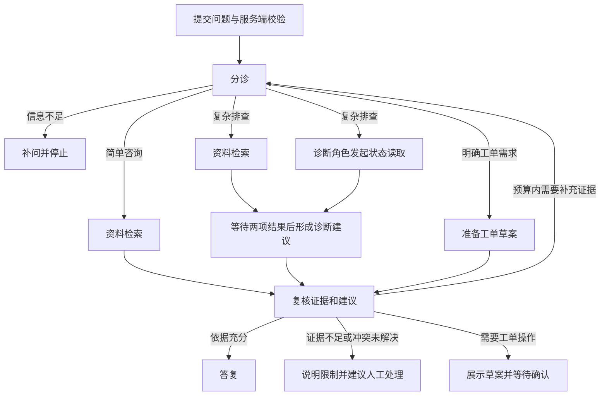

# 企业技术支持与工单协作：项目定位与开发计划

更新日期：2026-10-24。本文是项目总览；运行命令以 [README](../README.md) 为准，实际结果以 [实现与验证清单](实现与验证清单.md) 为准。

> 一句话：为软件公司的客服和技术支持人员开发一个助手，把“问清问题、查找资料、形成排查建议、复核、准备并确认工单”串成可追踪的流程。

先记住当前状态：**M0 已完成；当前运行规则与模拟工具，没有真实模型、四角色协作、数据库或工单写入。下面的完成体是开发目标。**

| 你想弄清楚什么 | 简短回答 |
| --- | --- |
| 为谁做？ | 软件公司的客服和技术支持人员；演示采用虚构产品 NimbusDesk |
| 什么时候用？ | 客户询问功能、反馈故障，或需要登记工单时 |
| 第一版处理什么？ | 产品咨询、故障排查、工单创建；变更工单留到后续增量 |
| 核心学习目标是什么？ | 有职责边界的四角色协作、结构化状态、受控工具与证据复核 |
| 当前重点到哪里？ | 先完成 M1–M2；可靠执行、MCP、部署和观测在后续阶段 |
| 是否是企业已上线产品？ | 当前是模拟业务原型，尚无已确认的企业合作、真实用户或上线结果 |

## 1. 这个项目具体做什么？

本项目采用“企业报表与数据分析软件的售后支持”作为业务场景。NimbusDesk 是被支持的虚构软件；我们开发的是为它提供技术支持的助手。

完成体组合三种能力：

| 能力 | 通俗理解 | 在本项目里的作用 | 当前状态 |
| --- | --- | --- | --- |
| 资料检索与证据管理 | 回答前先查对版本的资料 | 查产品手册、版本说明，后续加入模拟历史工单；返回证据 ID 和来源 | 已有本地 JSON 关键词查询；没有向量检索或完整 RAG 入库流水线 |
| 四角色按需协作 | 不同角色完成各自负责的步骤 | 分诊、资料、诊断、复核；简单问题走短路径，复杂问题才协作 | 未实现；当前是规则和普通业务函数 |
| 工单操作与可靠执行 | 把建议交接成可以追踪的业务结果 | 展示准确参数，确认后创建工单；保存结果、避免重复操作 | 仅有不保存的草案；确认、写入和恢复均未实现 |

示例目标：

> “客户使用 1.1 版本，导出月度报表时 30 秒后超时。请查对应版本的资料和服务状态，整理排查建议；如果需要工程师处理，准备工单供我确认。”

完成体应说明“依据是什么、可以尝试什么、还有什么不能确认”，再由用户确认具体业务操作。查到一条服务故障记录，不足以直接认定它就是当前问题的根因。

## 2. 主要应用场景与需求是什么？

### 2.1 谁使用，如何使用？

目标主要使用者是客服或技术支持人员：收到客户问题后，在页面输入产品、版本和故障信息，查看建议与证据，必要时确认工单参数。客户直接提交问题也可作为入口，权限由服务端检查。

当前只有两个本地演示身份，尚未建立真实客服/客户岗位体系或生产登录。

| 场景 | 输入示例 | 完成体希望给出的结果 | 现在能体验什么？ |
| --- | --- | --- | --- |
| 功能咨询 | “1.1 最多可以导出多少行 CSV？” | 引用对应版本的说明，直接回答 | 查询模拟手册；1.0 为 1000 行、1.1 为 5000 行，均为演示规则 |
| 故障排查 | “导出超时，30 秒后出现错误” | 补齐环境信息，结合资料和状态形成有证据的建议 | 字段充分后，依次返回模拟手册、版本说明及固定状态快照 |
| 信息不足 | “导出失败了” | 先问版本、错误信息和发生条件 | 返回待补信息，停止工具查询；补齐后重新提交完整请求 |
| 资料不足或冲突 | “登录超时”，或证据版本不一致 | 说明限制，补充调查或建议人工介入 | 登录超时没有匹配资料，会提示人工确认；冲突复核尚未实现 |
| 登记工单 | “请创建工单：导出报错” | 展示标题、描述、产品、版本等参数，确认后创建并返回编号 | 仅生成草案，尚无确认/创建端点或工单编号 |

### 2.2 为什么需要这个系统？

这里采用的需求假设是：客服处理一个问题，需要跨手册、版本说明和状态记录寻找依据，还要补问缺失信息，并把排查过程整理给工程师。

我们围绕这个假设设计四项需求：

1. **信息完整**：缺少关键上下文时先补问，避免带着错误版本或模糊现象开始判断。
2. **建议可核对**：给出来源，检查版本与事实是否一致，明确无法确定的部分。
3. **交接明确**：工单包含必要的环境、现象和排查记录，操作前展示完整参数。
4. **操作可解释**：查询失败、任务取消、进程重启或响应丢失后，能够说明状态和已产生的结果。

这些是当前产品设计假设，尚未经过真实企业访谈、客服试用或历史工单分析验证。不会编造节省工时、解决率或用户量。若后续有企业合作，另行记录需求来源、授权材料、职责和验收记录。

## 3. 具体功能与四角色如何分工？

### 3.1 四角色的职责边界（M1–M2 目标）

| 角色 | 主要输入 | 职责与可使用能力 | 结构化输出 | 边界 |
| --- | --- | --- | --- | --- |
| 分诊 Agent | 用户问题、已填写的产品/版本、上下文 | 提取候选信息；决定简单处理、复杂协作、补问或人工处理 | 意图、已知信息、缺失字段、建议路径 | 模型提取不能替代服务端的产品、版本与权限校验 |
| 资料 Agent | 已验证的产品/版本、查询目标 | 调用只读检索工具，寻找手册、版本说明及已授权历史工单 | 证据 ID、来源、内容、适用版本和检索限制 | 不修改工单，不把其他版本或其他用户的资料当作依据 |
| 诊断 Agent | 症状、已有证据、状态工具结果 | 发起受控服务状态查询；结合实际证据组织诊断假设与建议 | 建议、引用证据、待确认因素 | 工具失败就记录失败，不能补造正常状态或根因 |
| 复核 Agent | 资料、状态、诊断建议、拟操作内容 | 检查依据和冲突，决定答复、补充调查、人工处理或等待确认 | 复核结论、问题列表、下一步 | 不能替用户确认写操作，也不能绕过确定性权限与参数校验 |

角色通过结构化状态交换信息。状态至少应能承载问题上下文、证据、工具结果、诊断建议、复核结论、停止原因和调用预算；这是设计要求，当前尚无四角色共享状态实现。

不是每个问题都执行四个模型调用。简单咨询可以跳过诊断；规则能判断的字段和权限由代码校验。角色选择哪些受控工具、如何使用证据，才是需要验证的模型决策。

复杂问题中，资料检索和状态查询可以独立进行：状态查询是诊断角色的读取步骤，不额外命名为第五个 Agent。两项读取完成后，再组织诊断和复核。补充调查必须有次数上限，预算耗尽时停止并明确限制。

### 3.2 读取与写入功能

- **读取工具**：产品与版本查询、资料检索、服务状态查询，后续增加按资源归属限制的工单查询。
- **写入工具**：首个目标是创建工单；修改工单作为后续增量。写入前必须确认完整参数，参数改变后重新确认。
- **执行边界**：工具白名单、参数模型、服务端权限、超时和调用预算由确定性代码负责；审批记录和工单写入在 M3 实现。

当前 `ReadTools` 只有 `search_documents` 和 `get_service_status`，没有写工具。当前 `awaiting_confirmation` 只表示需要确认的草案，不代表已经保存了审批任务。

### 3.3 检索按需求逐步增加

当前资料集是三条模拟手册/版本说明和两个状态快照，适合先验证业务路径。知识规模和评测结果确实需要语义检索时，再增加文档处理、Embedding 和 pgvector；它不是验证 M2 四角色的强制前置条件。

BM25、BGE、RRF、Reranker、上下文优化及 LoRA 是用户已有经验，不能自动记成当前仓库功能。是否引入，取决于本项目的实际需求与验证结果。

## 4. 技术栈是什么，各自负责什么？

### 4.1 已使用与计划使用

| 层次 | 技术选择 | 通俗解释 | 引入阶段与状态 |
| --- | --- | --- | --- |
| 开发语言 | Python | 编写业务和工具逻辑 | 已使用；实测 3.12.5 |
| API 服务 | FastAPI、Uvicorn | 接收问题、调用业务、返回结果 | 已使用；固定 0.142.1 / 0.54.0 |
| 数据契约 | Pydantic | 规定输入、证据、结果和参数的格式 | 已使用；固定 2.13.4 |
| HTTP 调用与测试 | HTTPX | 调用 HTTP 接口；测试 API | 已使用；固定 0.28.1 |
| 交互入口 | 原生 HTML/JavaScript、Swagger | 在浏览器输入问题和查看结果 | 已有最小表单；未做浏览器点击验收，视觉后置 |
| 模型适配 | 一个 OpenAI 兼容接口 | 用统一接口调用配置的模型 | M1；未实现，地址/模型/密钥将由配置提供，不默认有付费凭据 |
| 角色编排 | LangGraph | 管理角色状态、路由、汇合和停止 | M2；已安装 1.2.9 但尚未使用，接入前重新核对兼容版本 |
| 业务持久化 | PostgreSQL、SQLAlchemy 异步访问方案 | 保存任务、执行记录、审批与工单 | M3；未接入。ORM/驱动版本在实现前检查并固定 |
| 向量检索 | PostgreSQL 的 pgvector 扩展 | 在现有数据库中查询语义相近资料 | 按实际检索需求引入，未接入；不另加重复向量库 |
| 后台队列 | Redis + ARQ | 投递长任务，由独立 Worker 执行 | M3；未接入 |
| 过程推送 | SSE | 把任务进度持续发送给页面 | M4；未接入，当前一次请求返回完整结果 |
| 工具协议 | 独立 MCP 服务 | 向外提供受控的产品/工单查询能力 | M4；未接入，服务端仍须检查权限 |
| 部署 | Docker Compose | 一起启动 API、Worker 和必要依赖 | M4；未提供配置或完成部署验证 |
| 观测 | 结构化日志，可选 Langfuse | 解释每一步发生了什么，辅助定位问题 | M4；未实现专用观测链，Langfuse 为可选项 |

当前直接依赖以 [requirements.txt](../requirements.txt) 为准。`.venv` 复用预装依赖，传递依赖尚未完整锁定，全新隔离安装未验证。后续组件不在本轮一并安装。

### 4.2 数据如何分工？（完成体设计）

| 存储 | 保存什么 | 不能把它当作什么 |
| --- | --- | --- |
| PostgreSQL | 业务任务、步骤记录、审批、工单、已保存结果，以及文档元数据 | 只有响应中的 request_id 还不等于持久化任务 |
| pgvector | 需要向量化时的文档向量，与文档及版本元数据关联 | 向量相似不代表版本正确或用户有权访问 |
| Redis | ARQ 投递、短期事件/取消提示和必要缓存 | 任务和工单最终状态的唯一事实来源 |
| 本地受控文件 | 初期模拟资料与导入数据 | 任意用户可访问的共享目录 |

本项目当前不规划 Yuxi 那样的 Milvus、Neo4j、MinIO、通用代码沙盒和完整部门管理界面。对象存储、知识图谱或复杂文件处理只有在出现具体需求时再评估；完整企业平台不属于当前范围。

## 5. 项目结构是什么？

### 5.1 当前实际目录

```text
D:\multi agent\
├─ support_app\
│  ├─ main.py                 API 和首页入口
│  ├─ models.py               请求、证据、结果、工单草案的数据格式
│  ├─ security.py             演示身份、产品与版本授权
│  ├─ routing.py              规则分诊与补问判断
│  ├─ service.py              当前业务流程与停止条件
│  ├─ tools.py                只读工具接口、模拟适配器、超时和预算
│  ├─ demo.html               最小交互页面
│  ├─ fixtures/product.json   模拟业务资料与状态
│  └─ __init__.py
├─ tests/test_support.py      自动化测试
├─ scripts/smoke_http.py      临时启动服务并验证 HTTP
├─ docs/                     总览、学习记录、参考阅读与验证证据
├─ README.md                 运行方式与现有功能
├─ tutorial.md               已实现源码的阅读路线
├─ practice.md               理解题与用户回答区
├─ requirements.txt          当前直接依赖
├─ .gitignore
└─ .venv/                    当前运行环境
```

### 5.2 后续模块边界（设计，不是已存在路径）

| 边界 | 后续负责的事 | 如何从现有代码演进 |
| --- | --- | --- |
| API | 请求校验、身份上下文、响应 | 保持 `main.py` 薄，不把所有业务写进端点 |
| 模型适配 | 统一调用、格式校验、模型错误和预算 | M1 新增；避免每个角色各写一套网络调用 |
| 角色与编排 | 角色契约、共享状态、路径和停止条件 | M2 新增，保留 `routing.py` 的规则基线作对照 |
| 工具与适配器 | 受控读取/写入、本地或远程实现 | 从 `ReadTools` 演进，读写边界分别定义 |
| 业务服务 | 组织支持流程、确认和工单操作 | 从 `SupportService` 演进 |
| 数据访问 | 事务、任务、执行记录、审批和工单 | M3 新增，数据查询不散落在角色提示词或路由中 |
| Worker | 消费任务、执行、续租、取消与故障收敛 | M3 新增，API 与耗时执行分离 |
| MCP 服务 | 工具发现、协议调用与服务端权限 | M4 单独运行，复用统一工具和校验边界 |

实际文件名随最小实现确定，当前不提前建立空目录或编造这些模块的调用链。

## 6. 用户发出问题，内部怎么运行？

### 6.1 当前实际运行链（M0）

```text
首页提交或 HTTP 客户端
→ POST /api/support
→ SupportRequest 结构校验 + get_principal 获得身份
→ SupportService.handle
→ validate_scope 检查产品/版本/权限
→ route_request
   ├─ 缺信息：补问并返回
   ├─ 未知意图：提示人工确认
   ├─ 工单请求：仅返回草案
   └─ 咨询/排查：ReadToolRunner.call
       → MockReadTools.search_documents
       → 排查且有资料时，再 get_service_status
       → 返回实际模拟证据和摘要
```

两项工具查询目前顺序执行。`request_id` 只区分响应；不保存任务或对话，不支持断线/重启后查询结果。资料不足或工具失败会停止，不伪造根因或状态。

### 6.2 四角色目标流程（M2 设计）



此图只表达设计中的业务路径。实现时需要明确汇合、最大调查次数、模型与工具调用预算；M2 的等待确认仍不执行真实工单写入。

### 6.3 长任务与工单执行目标（M3–M4 设计）

```text
API 校验并保存业务任务及待投递记录
→ 数据库事务提交
→ 发布到 Redis/ARQ
→ 独立 Worker 取得执行权后运行
→ 各步骤和最终结果保存到 PostgreSQL
→ 通过结果查询返回状态，M4 再增加 SSE 过程推送
```

审批应绑定用户、操作、资源及准确参数；参数改变后重新确认。业务工单通过受控写工具执行，当前计划先写入本项目的模拟工单库，不默认连接某家公司的真实工单系统。

必须验证的失败窗口包括：

- **数据库成功、投递失败**：保留待投递事实，能够补发。
- **消息重复到达**：执行权检查和业务幂等分别生效，不能重复创建工单。
- **Worker 失联**：明确哪些只读步骤可重跑，哪些写入需要先核对结果；状态不能永久卡住。
- **写入成功、响应丢失**：可以查询已保存结果；不能直接再次创建。
- **取消或客户端断线**：区分客户端停止等待与服务端取消；已完成的业务结果仍可解释。

以上是验收要求，不代表当前已有恢复机制，也不承诺任意步骤都可以自动继续。

## 7. 分阶段开发计划与验收

每轮只完成一个能运行、能解释、能验证的小目标，不按日历承诺尚未评估的工期。

| 阶段 | 本阶段做什么 | 最小验收证据 | 当前状态 |
| --- | --- | --- | --- |
| M0 规则基线 | API、数据契约、规则路由、模拟只读工具与草案 | 22 项自动化测试、7 个本地 HTTP 案例的既有记录 | 已完成，业务仍为 mock |
| M1 模型与角色契约 | 先分诊适配器，再逐步定义其他角色输入输出；可切换规则/mock/真实模式 | 正常结构、格式错误、不可用、缺信息、预算和配置行为；有凭据才单独验证真实接口 | 未开始 |
| M2 四角色协作，当前学习重点 | LangGraph 按需编排；独立查询并发；证据复核、停止条件及基线比较 | 简单咨询、跨来源排查、版本冲突、信息不足、工具失败；真实与 mock 结果分开记录 | 未开始 |
| M3 可靠执行与工单创建 | PostgreSQL、Redis/ARQ、独立 Worker；任务与结果持久化；确认、幂等、补发、取消和恢复边界 | 发布失败补偿、重复消息、进程中断、参数变更、成功响应丢失和越权案例 | 后续阶段 |
| M4 MCP、交付与评测 | 独立 MCP 服务、Compose、初始化数据、SSE、日志和可选追踪 | 工具发现/调用/越权拒绝、本地服务链、结果查询与推送、分层评测记录 | 后续阶段 |

M1 内部先完成一个小步：**新增可注入的分诊模型适配器和结构化输出契约，用 fake/mock 验证正常输出、格式错误和不可用。** 不同时引入数据库、队列或四角色完整编排。

真实模型名称、地址、密钥通过配置提供。mock 模式必须显式标识；真实模式配置缺失或调用失败时，不能静默换成 mock 并声称真实调用成功。当前 mock 工具的 0.5 秒单次超时和 2 秒只读阶段预算，不直接套用为未来模型调用的超时配置。

M2 的对照应使用相同资料和案例，区分规则基线、单 Agent 和四角色版本。只有测量后才记录证据支持、版本冲突识别、路径选择、调用数量、成本或延迟；不预设多 Agent 必然更好。

M4 的接口压力测试与真实模型端到端性能分别记录；第三方监测不可用时仍应能通过本地日志和执行记录解释结果。

## 8. 现在如何运行、学习和介绍？

### 8.1 运行与验证

在 `D:\multi agent` 运行：

```powershell
.\.venv\Scripts\python.exe -X utf8 -m uvicorn support_app.main:app --host 127.0.0.1 --port 8000
```

打开 <http://127.0.0.1:8000/>，选 `dev-alice`、产品 `nimbusdesk`、版本 `1.1`。先试“导出 CSV 最多多少行？”，再试“导出超时怎么办？”并填写 symptom。它们都只访问本地模拟数据。

```powershell
.\.venv\Scripts\python.exe -X utf8 -m unittest discover -s tests -v
.\.venv\Scripts\python.exe -X utf8 scripts\smoke_http.py
```

现有测试输出见 [m0-unittest.txt](validation/m0-unittest.txt)，HTTP 记录见 [m0-http.json](validation/m0-http.json)，后者记录日期为 2026-10-23。本次编写总览只核对文件、来源记录和文档链接，没有重跑测试、启动服务或调用模型。浏览器点击、真实模型、数据库和部署仍未验证。

阅读顺序：先看 [main.py](../support_app/main.py) 的入口，再看 [service.py](../support_app/service.py) 的分支，最后看 [tools.py](../support_app/tools.py) 的工具和预算。详细解释见 [tutorial.md](../tutorial.md)，理解题见 [practice.md](../practice.md)。

### 8.2 面试时如何说明需求？

可以按当前事实介绍：

> “这是一个面向软件客服和技术支持人员的实践项目。我以虚构的报表软件为场景，把补问、版本资料查询、服务状态查询和工单整理串起来。当前项目完成了规则与模拟工具驱动的最小流程，后续重点是四角色协作和可靠工单执行。需求目前来自场景建模，尚未有真实企业用户验证。”

校企合作、真实数据、个人职责、实际试用和上线结果需要各自的事实依据，不能从演示项目中推导出来。AI 辅助开发与用户已经掌握的部分也应分别记录。

### 8.3 与 Yuxi 的关系及参考资料

Yuxi 是通用知识智能体平台；我们聚焦一段技术支持与工单流程。本项目完成体不以复制其全部模块为目标。到具体问题出现时，参考它的职责边界、提交后投递、子任务关系和失败收敛等实现。

此前核对的 Yuxi 分支为 `main`，提交为 `928141ceb2799cee18bcdbc060618ab9151ba48b`，项目本体 MIT；我们没有移植其代码或运行它。详见 [参考阅读-Yuxi](参考阅读-Yuxi.md)、[固定版本架构说明](https://github.com/xerrors/Yuxi/blob/928141ceb2799cee18bcdbc060618ab9151ba48b/ARCHITECTURE.md)。Yuxi 的功能与效果不记作我们的成果。

Enterprise Deep Research、support-agent 原项目和用户 fork 仍是待按需阅读的参考对象，当前未核验其源码与许可。后续使用时记录实际路径、提交、许可和实现差异。

理解题：

1. 为什么“先问版本、按版本找资料”是业务需求，而“四个 Agent”是实现方案？
2. 为什么状态查询可以与资料检索并发，形成诊断建议却需要等待相关结果？
3. 工单草案、用户确认、工单成功写入分别代表什么，当前项目做到哪一步？

用户笔记与场景调整：后续在此追加，保留已有笔记。

